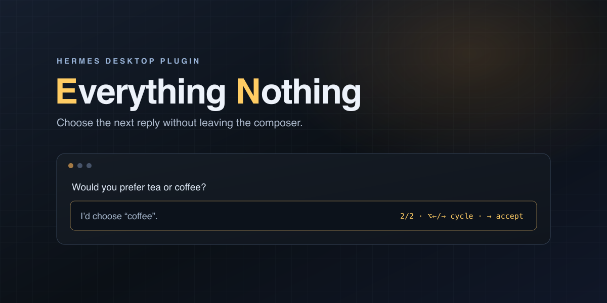

# Everything Nothing for Hermes



Next Prompt is the first feature in Everything Nothing. Its installed ID and
auxiliary model slot stay compatible with existing Hermes settings.

Next Prompt shows an editable reply preview in an empty Hermes Desktop composer.
Press **Right Arrow** to accept it into the draft. For a choice with multiple
options, press **Option+Left/Right** (Alt+Left/Right) to cycle before accepting.
Open the command palette to use or dismiss the current suggestion.

## Settings and diagnostics

Open **Settings → Plugins → Everything Nothing** for the active Hermes profile.
Turn off **Offer extra follow-up choices** to keep a single follow-up when
Hermes has not offered explicit choices. Selecting text in the composer or
editing and clearing the draft returns a cycled preview to the first option.

**Test Suggestion** runs a synthetic tea-or-coffee example on that profile.
It shows the actual provider and model when a model returns, plus the backend
elapsed time. Enable **Force offline fallback for this test** to bypass the
model call for just that run. The diagnostic does not modify the pending
suggestion store, chat history, or model settings.

## How suggestions work

The plugin extracts explicit choices from the assistant’s final message.
It constructs the replies itself and asks the configured model to rank them by
number. For other turns the configured Next Prompt model proposes the next useful
step toward the user's goal, using the current request, stated constraints,
recent exchanges, and a larger slice of the completed reply. The default context
is eight messages (four exchanges); an explicit saved context limit is preserved.
Suggestions can be short questions or requests such as “Make a migration checklist”.
They target 5–10 words and stay within 96 characters (18 words maximum).

The model prioritizes unfinished work, blockers, decisions, and relevant checks,
rather than asking for facts already explained. Standalone reply-format directives
are removed from the intent view so “no closing question” does not hide the user's
goal. Explicit requests to disable suggestions are still respected. Clear conflicts
with a stated inability to use Terminal are filtered before publishing. Rejected
drafts no longer discard good alternatives. Model results are not padded with generic questions. The prompt and output checks
guard against claims that the user completed an unconfirmed action.

Each call allows 15 seconds per provider attempt. An unloadable compatibility
adapter marks only this task's loopback Splash requests as foreground, and avoids
replaying full-timeout failures. Fast transport blips still use Hermes retries;
other tasks, cloud routes, credentials, model selection, and explicit priority
settings stay with Hermes. Hosts without the required policy hooks retain their
existing behavior and log a warning. The current answer is sent once rather than
duplicated in recent history; earlier goals and constraints remain available.
One reply-only recovery call remains available for model abstention. Suggestions
run in the background and are discarded if the conversation moves on. Drafts are
previews, never automatic sends or permission to execute. Explicit choices retain
the existing quoted-choice ranking behavior.

The dependency-free local fallback offers detected choices in their original
order, a clarification for a question, or safe generic questions after a
substantial explanation if the model fails or cannot supply useful questions. It runs on
the Hermes backend and needs no model weights, network, or separate process.
Set `plugins.entries.next-prompt.settings.local_fallback` to false to disable
the fallback on model failure. Choice detection and follow-up templates are
currently English-oriented. The parser handles up to four explicit options.

## Choose the suggestion model

In Hermes Desktop, open **Settings → Models → Auxiliary → Next Prompt** for
the profile that runs the chat. Select a configured provider and model.
A local model already connected to that Hermes profile is available through
its configured provider. The default follows the main chat model.
You can also use `hermes model` → **Auxiliary** → **Next Prompt** or set
`auxiliary.next_prompt.provider` and `auxiliary.next_prompt.model` in that
profile's config. No separate plugin credentials are needed.

## Deployment

This fork retains the `next-prompt` plugin ID and the existing authenticated
REST route. Install the fork backend in the profile that runs chat turns
and its desktop bundle on the machine running Desktop. If the two are on
different machines, update both. Use a pinned revision of the fork when
distributing it. On Mac-2, the existing standalone desktop override must be
updated explicitly. A stock catalog update does not manage that override.

Reload the backend processes that run turns and serve plugin routes after
updating Python, then use **Reload desktop plugins** in Desktop. The database
upgrade adds one optional column and preserves existing rows. The fork
desktop suppresses pending replies produced by the old unrestricted generator.
Older desktops can still read the first suggestion from the fork backend.

The preview uses Hermes Desktop's composer markup, since the SDK does not
provide an inline preview slot. Insertion uses the SDK's composer API. This
local integration may need adjustment if Hermes changes its composer markup.

## Development

```sh
python -m unittest discover -s tests
node --test tests/frontend/plugin.test.mjs
```

MIT. Forked from [soymarketing/hermes-plugin-next-prompt](https://github.com/soymarketing/hermes-plugin-next-prompt).
